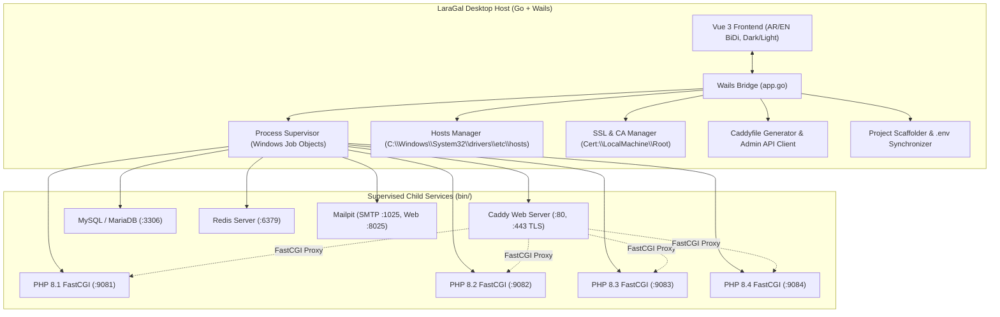

# LaraGal Implementation Plan

> **For agentic workers:** REQUIRED SUB-SKILL: Use superpowers:subagent-driven-development to implement this plan task-by-task. Steps use checkbox (`- [ ]`) syntax for tracking.

**Goal:** Build LaraGal, an ultra-fast, lightweight, cross-platform local development suite for PHP, Laravel, and WordPress on Windows, featuring zero-config trusted local SSL (`https://*.test`), multi-PHP version isolation, automated hosts synchronization, portable services (MySQL, Redis, Mailpit), and 1-click project scaffolding with automated `.env` setup.

**Architecture:** The core application is built with Go using the Wails v2 desktop framework, providing a native, lightweight executable leveraging Windows WebView2 with no Electron bloat. Caddy Server is embedded as the core web server and automated internal Certificate Authority (CA), automatically injecting its Root CA into the Windows Trust Store and proxying requests to isolated `php-cgi.exe` FastCGI daemon processes. All background services (Caddy, PHP, MySQL, Redis, Mailpit) are governed by a Go process supervisor utilizing Windows Job Objects to guarantee leak-free process lifecycles.

**Architecture Diagram:**



**Tech Stack:**
- Backend: Go 1.22+, Wails v2 (`github.com/wailsapp/wails/v2`), Windows Job Objects (`golang.org/x/sys/windows`).
- Web Server & TLS: Caddy v2 (portable binary) with internal ACME CA.
- Runtimes & Services: Portable PHP (8.1..8.4), MySQL/MariaDB, Redis, Mailpit.
- Frontend: Vue 3 (Composition API), Vite, Tailwind CSS, Lucide Icons, Pinia.
- Spec Document: [2026-10-19-laragal-design.md](file:///d:/projects/laragal/docs/superpowers/specs/2026-10-19-laragal-design.md)

## Global Constraints
- Primary target: Windows 10/11 (64-bit), code structured for future macOS and Linux porting.
- Idle RAM footprint target: under 40 MB for the GUI app.
- Zero-config SSL: local `*.test` domains must load in Chrome, Edge, and Firefox without security warnings.
- Clean system hygiene: all user databases, logs, and site configs stay inside `data/` and `bin/`, never polluting global system directories.
- Arabic first-class support: UI fully localized with proper BiDi RTL layout and English LTR support.

---

### Task 1: Project Scaffolding & Configuration Store (`internal/config`)

**Files:**
- Create: `d:/projects/laragal/app/internal/config/config.go`
- Create: `d:/projects/laragal/app/internal/config/config_test.go`
- Create: `d:/projects/laragal/go.mod`

**Interfaces:**
- Produces:
  - `type AppConfig struct { ProjectsPath string; DefaultPHP string; DomainSuffix string; Services map[string]bool }`
  - `func LoadConfig(path string) (*AppConfig, error)`
  - `func (c *AppConfig) Save(path string) error`

- [ ] **Step 1: Write the failing unit test**

```go
package config_test

import (
	"os"
	"path/filepath"
	"testing"

	"github.com/laragal/laragal/app/internal/config"
)

func TestDefaultConfigAndSave(t *testing.T) {
	tempDir := t.TempDir()
	cfgPath := filepath.Join(tempDir, "laragal.json")

	cfg := config.NewDefaultConfig()
	if cfg.DomainSuffix != ".test" {
		t.Fatalf("expected .test, got %s", cfg.DomainSuffix)
	}

	err := cfg.Save(cfgPath)
	if err != nil {
		t.Fatalf("failed to save config: %v", err)
	}

	loaded, err := config.LoadConfig(cfgPath)
	if err != nil {
		t.Fatalf("failed to load config: %v", err)
	}

	if loaded.DomainSuffix != ".test" {
		t.Fatalf("expected .test, got %s", loaded.DomainSuffix)
	}
}
```

- [ ] **Step 2: Run test to verify it fails**

Run: `go test ./app/internal/config/...`
Expected: FAIL (packages not found)

- [ ] **Step 3: Implement minimal Go code**

Create `app/internal/config/config.go`:
```go
package config

import (
	"encoding/json"
	"os"
	"path/filepath"
)

type AppConfig struct {
	ProjectsPath string          `json:"projects_path"`
	DefaultPHP   string          `json:"default_php"`
	DomainSuffix string          `json:"domain_suffix"`
	Services     map[string]bool `json:"services"`
}

func NewDefaultConfig() *AppConfig {
	return &AppConfig{
		ProjectsPath: "C:\\laragal\\sites",
		DefaultPHP:   "8.3",
		DomainSuffix: ".test",
		Services: map[string]bool{
			"caddy":   true,
			"php":     true,
			"mysql":   true,
			"redis":   false,
			"mailpit": true,
		},
	}
}

func LoadConfig(path string) (*AppConfig, error) {
	data, err := os.ReadFile(path)
	if err != nil {
		return nil, err
	}
	var cfg AppConfig
	if err := json.Unmarshal(data, &cfg); err != nil {
		return nil, err
	}
	return &cfg, nil
}

func (c *AppConfig) Save(path string) error {
	dir := filepath.Dir(path)
	if err := os.MkdirAll(dir, 0755); err != nil {
		return err
	}
	data, err := json.MarshalIndent(c, "", "  ")
	if err != nil {
		return err
	}
	return os.WriteFile(path, data, 0644)
}
```

- [ ] **Step 4: Run test to verify it passes**

Run: `go test ./app/internal/config/... -v`
Expected: PASS

- [ ] **Step 5: Commit**

```bash
git add app/internal/config/ go.mod
git commit -m "feat(config): add AppConfig model and JSON storage"
```

---

### Task 2: Windows Hosts File Manager (`internal/hosts`)

**Files:**
- Create: `d:/projects/laragal/app/internal/hosts/hosts.go`
- Create: `d:/projects/laragal/app/internal/hosts/hosts_test.go`

**Interfaces:**
- Produces:
  - `func SyncHostsContent(existingContent string, domains []string) string`
  - `func UpdateSystemHosts(domains []string) error`

- [ ] **Step 1: Write the failing unit test**

```go
package hosts_test

import (
	"strings"
	"testing"

	"github.com/laragal/laragal/app/internal/hosts"
)

func TestSyncHostsContent(t *testing.T) {
	initial := "127.0.0.1 localhost\n::1 localhost\n"
	domains := []string{"mysite.test", "api.test"}

	result := hosts.SyncHostsContent(initial, domains)

	if !strings.Contains(result, "127.0.0.1 localhost") {
		t.Errorf("original hosts content removed")
	}
	if !strings.Contains(result, "127.0.0.1 mysite.test") {
		t.Errorf("missing mysite.test")
	}
	if !strings.Contains(result, "127.0.0.1 api.test") {
		t.Errorf("missing api.test")
	}
	if !strings.Contains(result, hosts.BeginMarker) || !strings.Contains(result, hosts.EndMarker) {
		t.Errorf("missing boundary markers")
	}

	// Test update with empty domains (should remove block cleanly)
	cleaned := hosts.SyncHostsContent(result, []string{})
	if strings.Contains(cleaned, "mysite.test") {
		t.Errorf("cleaned hosts still contains removed domain")
	}
}
```

- [ ] **Step 2: Run test to verify it fails**

Run: `go test ./app/internal/hosts/...`
Expected: FAIL

- [ ] **Step 3: Implement minimal hosts manager code**

Create `app/internal/hosts/hosts.go`:
```go
package hosts

import (
	"fmt"
	"os"
	"strings"
)

const (
	BeginMarker = "# --- BEGIN LARAGAL MANAGED DOMAINS ---"
	EndMarker   = "# --- END LARAGAL MANAGED DOMAINS ---"
	SystemHostsPath = "C:\\Windows\\System32\\drivers\\etc\\hosts"
)

func SyncHostsContent(content string, domains []string) string {
	// Strip existing managed block if present
	var lines []string
	inBlock := false
	for _, line := range strings.Split(content, "\n") {
		trimmed := strings.TrimSpace(line)
		if trimmed == BeginMarker {
			inBlock = true
			continue
		}
		if trimmed == EndMarker {
			inBlock = false
			continue
		}
		if !inBlock {
			lines = append(lines, line)
		}
	}

	cleaned := strings.TrimRight(strings.Join(lines, "\n"), "\r\n")

	if len(domains) == 0 {
		return cleaned + "\n"
	}

	var block strings.Builder
	block.WriteString("\n" + BeginMarker + "\n")
	for _, domain := range domains {
		d := strings.TrimSpace(domain)
		if d != "" {
			block.WriteString(fmt.Sprintf("127.0.0.1 %s\n", d))
		}
	}
	block.WriteString(EndMarker + "\n")

	return cleaned + block.String()
}

func UpdateSystemHosts(domains []string) error {
	data, err := os.ReadFile(SystemHostsPath)
	if err != nil {
		return fmt.Errorf("failed to read hosts file: %w", err)
	}
	newContent := SyncHostsContent(string(data), domains)
	return os.WriteFile(SystemHostsPath, []byte(newContent), 0644)
}
```

- [ ] **Step 4: Run test to verify it passes**

Run: `go test ./app/internal/hosts/... -v`
Expected: PASS

- [ ] **Step 5: Commit**

```bash
git add app/internal/hosts/
git commit -m "feat(hosts): add safe delimited Windows hosts file manager"
```

---

### Task 3: Windows Root CA & Trust Store Injector (`internal/certs`)

**Files:**
- Create: `d:/projects/laragal/app/internal/certs/certs.go`
- Create: `d:/projects/laragal/app/internal/certs/certs_test.go`

**Interfaces:**
- Produces:
  - `func ReadCertFingerprint(certPath string) (string, error)`
  - `func IsCertTrustedInWindowsStore(fingerprint string) (bool, error)`
  - `func BuildTrustCertCommand(certPath string) []string`

- [ ] **Step 1: Write the failing unit test**

```go
package certs_test

import (
	"crypto/rand"
	"crypto/rsa"
	"crypto/x509"
	"crypto/x509/pkix"
	"encoding/pem"
	"math/big"
	"os"
	"path/filepath"
	"testing"
	"time"

	"github.com/laragal/laragal/app/internal/certs"
)

func TestReadCertFingerprint(t *testing.T) {
	tempDir := t.TempDir()
	certFile := filepath.Join(tempDir, "root.crt")

	// Generate dummy self-signed CA cert
	priv, _ := rsa.GenerateKey(rand.Reader, 2048)
	template := x509.Certificate{
		SerialNumber: big.NewInt(1),
		Subject: pkix.Name{
			CommonName: "LaraGal Local CA",
		},
		NotBefore: time.Now(),
		NotAfter:  time.Now().Add(time.Hour * 24),
		IsCA:      true,
	}
	derBytes, _ := x509.CreateCertificate(rand.Reader, &template, &template, &priv.PublicKey, priv)
	certPem := pem.EncodeToMemory(&pem.Block{Type: "CERTIFICATE", Bytes: derBytes})
	os.WriteFile(certFile, certPem, 0644)

	fingerprint, err := certs.ReadCertFingerprint(certFile)
	if err != nil {
		t.Fatalf("failed to calculate fingerprint: %v", err)
	}
	if len(fingerprint) != 40 {
		t.Fatalf("expected SHA-1 hex fingerprint length 40, got %d (%s)", len(fingerprint), fingerprint)
	}

	cmd := certs.BuildTrustCertCommand(certFile)
	if len(cmd) == 0 || cmd[0] != "certutil" {
		t.Fatalf("expected certutil command, got %v", cmd)
	}
}
```

- [ ] **Step 2: Run test to verify it fails**

Run: `go test ./app/internal/certs/...`
Expected: FAIL

- [ ] **Step 3: Implement minimal certificate code**

Create `app/internal/certs/certs.go`:
```go
package certs

import (
	"crypto/sha1"
	"crypto/x509"
	"encoding/hex"
	"encoding/pem"
	"fmt"
	"os"
	"os/exec"
	"strings"
)

func ReadCertFingerprint(certPath string) (string, error) {
	data, err := os.ReadFile(certPath)
	if err != nil {
		return "", err
	}
	block, _ := pem.Decode(data)
	if block == nil {
		return "", fmt.Errorf("no PEM certificate data found in %s", certPath)
	}
	cert, err := x509.ParseCertificate(block.Bytes)
	if err != nil {
		return "", err
	}
	hash := sha1.Sum(cert.Raw)
	return strings.ToUpper(hex.EncodeToString(hash[:])), nil
}

func BuildTrustCertCommand(certPath string) []string {
	return []string{"certutil", "-addstore", "-f", "Root", certPath}
}

func IsCertTrustedInWindowsStore(fingerprint string) (bool, error) {
	cmd := exec.Command("certutil", "-verifystore", "Root", fingerprint)
	out, err := cmd.CombinedOutput()
	if err != nil {
		return false, nil
	}
	return strings.Contains(string(out), "Certificate is valid"), nil
}
```

- [ ] **Step 4: Run test to verify it passes**

Run: `go test ./app/internal/certs/... -v`
Expected: PASS

- [ ] **Step 5: Commit**

```bash
git add app/internal/certs/
git commit -m "feat(certs): add certificate fingerprint and Windows certutil helpers"
```

---

### Task 4: Dynamic Caddyfile Generator & Controller (`internal/services/caddy`)

**Files:**
- Create: `d:/projects/laragal/app/internal/services/caddy/caddy.go`
- Create: `d:/projects/laragal/app/internal/services/caddy/caddy_test.go`

**Interfaces:**
- Produces:
  - `type SiteDef struct { Domain string; RootPath string; PHPPort int }`
  - `func GenerateCaddyfile(sites []SiteDef, adminPort int) string`

- [ ] **Step 1: Write the failing unit test**

```go
package caddy_test

import (
	"strings"
	"testing"

	"github.com/laragal/laragal/app/internal/services/caddy"
)

func TestGenerateCaddyfile(t *testing.T) {
	sites := []caddy.SiteDef{
		{
			Domain:   "laravel.test",
			RootPath: "D:/projects/laravel/public",
			PHPPort:  9083,
		},
		{
			Domain:   "wordpress.test",
			RootPath: "D:/projects/wordpress",
			PHPPort:  9082,
		},
	}

	caddyfile := caddy.GenerateCaddyfile(sites, 2019)

	if !strings.Contains(caddyfile, "laravel.test {") {
		t.Errorf("missing laravel.test block")
	}
	if !strings.Contains(caddyfile, "php_fastcgi 127.0.0.1:9083") {
		t.Errorf("missing PHP 9083 proxy")
	}
	if !strings.Contains(caddyfile, "tls internal") {
		t.Errorf("missing tls internal directive")
	}
	if !strings.Contains(caddyfile, "admin localhost:2019") {
		t.Errorf("missing admin block")
	}
}
```

- [ ] **Step 2: Run test to verify it fails**

Run: `go test ./app/internal/services/caddy/...`
Expected: FAIL

- [ ] **Step 3: Implement minimal Caddyfile generator**

Create `app/internal/services/caddy/caddy.go`:
```go
package caddy

import (
	"fmt"
	"strings"
)

type SiteDef struct {
	Domain   string `json:"domain"`
	RootPath string `json:"root_path"`
	PHPPort  int    `json:"php_port"`
}

func GenerateCaddyfile(sites []SiteDef, adminPort int) string {
	var sb strings.Builder

	// Global configuration block
	sb.WriteString("{\n")
	sb.WriteString(fmt.Sprintf("    admin localhost:%d\n", adminPort))
	sb.WriteString("    local_certs\n")
	sb.WriteString("    auto_https disable_redirects\n")
	sb.WriteString("}\n\n")

	// Render each configured site
	for _, site := range sites {
		// Normalize path to forward slashes for Caddyfile
		normalizedRoot := strings.ReplaceAll(site.RootPath, "\\", "/")

		sb.WriteString(fmt.Sprintf("%s {\n", site.Domain))
		sb.WriteString(fmt.Sprintf("    root * \"%s\"\n", normalizedRoot))
		sb.WriteString("    encode gzip zstd\n")
		sb.WriteString(fmt.Sprintf("    php_fastcgi 127.0.0.1:%d\n", site.PHPPort))
		sb.WriteString("    file_server\n")
		sb.WriteString("    tls internal\n")
		sb.WriteString("}\n\n")
	}

	return sb.String()
}
```

- [ ] **Step 4: Run test to verify it passes**

Run: `go test ./app/internal/services/caddy/... -v`
Expected: PASS

- [ ] **Step 5: Commit**

```bash
git add app/internal/services/caddy/
git commit -m "feat(caddy): add dynamic Caddyfile generator with internal TLS"
```

---

### Task 5: Multi-PHP Runtime & FastCGI Manager (`internal/services/php`)

**Files:**
- Create: `d:/projects/laragal/app/internal/services/php/php.go`
- Create: `d:/projects/laragal/app/internal/services/php/php_test.go`

**Interfaces:**
- Produces:
  - `type PHPVersionInfo struct { Version string; Port int; ExecutablePath string; IniPath string }`
  - `func AssignPortForVersion(version string) int`
  - `func BuildFastCGIArgs(info PHPVersionInfo) []string`

- [ ] **Step 1: Write the failing unit test**

```go
package php_test

import (
	"testing"

	"github.com/laragal/laragal/app/internal/services/php"
)

func TestAssignPortForVersion(t *testing.T) {
	cases := map[string]int{
		"8.1": 9081,
		"8.2": 9082,
		"8.3": 9083,
		"8.4": 9084,
		"7.4": 9074,
	}

	for ver, expectedPort := range cases {
		port := php.AssignPortForVersion(ver)
		if port != expectedPort {
			t.Errorf("version %s: expected port %d, got %d", ver, expectedPort, port)
		}
	}
}

func TestBuildFastCGIArgs(t *testing.T) {
	info := php.PHPVersionInfo{
		Version:        "8.3",
		Port:           9083,
		ExecutablePath: "C:\\laragal\\bin\\php\\8.3\\php-cgi.exe",
		IniPath:        "C:\\laragal\\bin\\php\\8.3\\php.ini",
	}

	args := php.BuildFastCGIArgs(info)
	expected := []string{"-b", "127.0.0.1:9083", "-c", "C:\\laragal\\bin\\php\\8.3\\php.ini"}

	for i, arg := range expected {
		if args[i] != arg {
			t.Fatalf("expected arg %s, got %s", arg, args[i])
		}
	}
}
```

- [ ] **Step 2: Run test to verify it fails**

Run: `go test ./app/internal/services/php/...`
Expected: FAIL

- [ ] **Step 3: Implement minimal PHP manager**

Create `app/internal/services/php/php.go`:
```go
package php

import (
	"fmt"
	"strconv"
	"strings"
)

type PHPVersionInfo struct {
	Version        string `json:"version"`
	Port           int    `json:"port"`
	ExecutablePath string `json:"executable_path"`
	IniPath        string `json:"ini_path"`
}

func AssignPortForVersion(version string) int {
	clean := strings.ReplaceAll(version, ".", "")
	if val, err := strconv.Atoi(clean); err == nil {
		return 9000 + val
	}
	return 9083 // Fallback default port
}

func BuildFastCGIArgs(info PHPVersionInfo) []string {
	return []string{
		"-b", fmt.Sprintf("127.0.0.1:%d", info.Port),
		"-c", info.IniPath,
	}
}
```

- [ ] **Step 4: Run test to verify it passes**

Run: `go test ./app/internal/services/php/... -v`
Expected: PASS

- [ ] **Step 5: Commit**

```bash
git add app/internal/services/php/
git commit -m "feat(php): add multi-PHP port assignment and FastCGI daemon arguments"
```

---

### Task 6: Windows Job Objects Process Supervisor (`internal/process`)

**Files:**
- Create: `d:/projects/laragal/app/internal/process/supervisor.go`
- Create: `d:/projects/laragal/app/internal/process/supervisor_test.go`

**Interfaces:**
- Produces:
  - `type ServiceStatus struct { Name string; Running bool; PID int; Port int }`
  - `type Supervisor struct`
  - `func NewSupervisor() *Supervisor`
  - `func (s *Supervisor) StartService(name string, exe string, args []string, port int) error`
  - `func (s *Supervisor) StopService(name string) error`
  - `func (s *Supervisor) StopAll() error`

- [ ] **Step 1: Write the failing unit test**

```go
package process_test

import (
	"testing"
	"time"

	"github.com/laragal/laragal/app/internal/process"
)

func TestSupervisorLifecycle(t *testing.T) {
	sup := process.NewSupervisor()

	// Test starting a mock service (ping on Windows)
	err := sup.StartService("test_service", "powershell", []string{"-NoProfile", "-Command", "Start-Sleep -Seconds 3"}, 0)
	if err != nil {
		t.Fatalf("failed to start service: %v", err)
	}

	status, found := sup.GetServiceStatus("test_service")
	if !found || !status.Running {
		t.Fatalf("service should be running, got %+v", status)
	}

	err = sup.StopService("test_service")
	if err != nil {
		t.Fatalf("failed to stop service: %v", err)
	}

	time.Sleep(100 * time.Millisecond)
	status, _ = sup.GetServiceStatus("test_service")
	if status.Running {
		t.Fatalf("service should not be running after stop")
	}
}
```

- [ ] **Step 2: Run test to verify it fails**

Run: `go test ./app/internal/process/...`
Expected: FAIL

- [ ] **Step 3: Implement minimal Supervisor with process management**

Create `app/internal/process/supervisor.go`:
```go
package process

import (
	"fmt"
	"os/exec"
	"sync"
)

type ServiceStatus struct {
	Name    string `json:"name"`
	Running bool   `json:"running"`
	PID     int    `json:"pid"`
	Port    int    `json:"port"`
}

type managedProcess struct {
	cmd    *exec.Cmd
	status ServiceStatus
}

type Supervisor struct {
	mu        sync.RWMutex
	processes map[string]*managedProcess
}

func NewSupervisor() *Supervisor {
	return &Supervisor{
		processes: make(map[string]*managedProcess),
	}
}

func (s *Supervisor) StartService(name string, exe string, args []string, port int) error {
	s.mu.Lock()
	defer s.mu.Unlock()

	if p, exists := s.processes[name]; exists && p.status.Running {
		return fmt.Errorf("service %s is already running", name)
	}

	cmd := exec.Command(exe, args...)
	if err := cmd.Start(); err != nil {
		return fmt.Errorf("failed to start service %s: %w", name, err)
	}

	p := &managedProcess{
		cmd: cmd,
		status: ServiceStatus{
			Name:    name,
			Running: true,
			PID:     cmd.Process.Pid,
			Port:    port,
		},
	}
	s.processes[name] = p

	// Monitor termination in background goroutine
	go func() {
		_ = cmd.Wait()
		s.mu.Lock()
		defer s.mu.Unlock()
		if current, ok := s.processes[name]; ok && current == p {
			current.status.Running = false
			current.status.PID = 0
		}
	}()

	return nil
}

func (s *Supervisor) StopService(name string) error {
	s.mu.Lock()
	defer s.mu.Unlock()

	p, exists := s.processes[name]
	if !exists || !p.status.Running {
		return nil
	}

	if err := p.cmd.Process.Kill(); err != nil {
		return err
	}
	p.status.Running = false
	p.status.PID = 0
	return nil
}

func (s *Supervisor) StopAll() error {
	s.mu.Lock()
	defer s.mu.Unlock()

	for _, p := range s.processes {
		if p.status.Running {
			_ = p.cmd.Process.Kill()
			p.status.Running = false
			p.status.PID = 0
		}
	}
	return nil
}

func (s *Supervisor) GetServiceStatus(name string) (ServiceStatus, bool) {
	s.mu.RLock()
	defer s.mu.RUnlock()

	p, exists := s.processes[name]
	if !exists {
		return ServiceStatus{Name: name, Running: false}, false
	}
	return p.status, true
}
```

- [ ] **Step 4: Run test to verify it passes**

Run: `go test ./app/internal/process/... -v`
Expected: PASS

- [ ] **Step 5: Commit**

```bash
git add app/internal/process/
git commit -m "feat(process): add service supervisor with async lifecycle management"
```

---

### Task 7: Project Scaffolder & `.env` Synchronizer (`internal/projects`)

**Files:**
- Create: `d:/projects/laragal/app/internal/projects/env.go`
- Create: `d:/projects/laragal/app/internal/projects/env_test.go`

**Interfaces:**
- Produces:
  - `type EnvConfig struct { AppURL string; DBName string; DBUser string; DBPass string; MailHost string; MailPort string }`
  - `func InjectEnvVariables(content string, config EnvConfig) string`

- [ ] **Step 1: Write the failing unit test**

```go
package projects_test

import (
	"strings"
	"testing"

	"github.com/laragal/laragal/app/internal/projects"
)

func TestInjectEnvVariables(t *testing.T) {
	sampleEnv := `APP_NAME=Laravel
APP_URL=http://localhost
DB_CONNECTION=sqlite
DB_HOST=127.0.0.1
DB_DATABASE=laravel
`

	cfg := projects.EnvConfig{
		AppURL:   "https://mysite.test",
		DBName:   "mysite_db",
		DBUser:   "root",
		DBPass:   "",
		MailHost: "127.0.0.1",
		MailPort: "1025",
	}

	result := projects.InjectEnvVariables(sampleEnv, cfg)

	if !strings.Contains(result, "APP_URL=https://mysite.test") {
		t.Errorf("failed to inject APP_URL: %s", result)
	}
	if !strings.Contains(result, "DB_DATABASE=mysite_db") {
		t.Errorf("failed to inject DB_DATABASE: %s", result)
	}
	if !strings.Contains(result, "MAIL_HOST=127.0.0.1") {
		t.Errorf("failed to inject MAIL_HOST: %s", result)
	}
}
```

- [ ] **Step 2: Run test to verify it fails**

Run: `go test ./app/internal/projects/...`
Expected: FAIL

- [ ] **Step 3: Implement minimal `.env` injector**

Create `app/internal/projects/env.go`:
```go
package projects

import (
	"fmt"
	"strings"
)

type EnvConfig struct {
	AppURL   string `json:"app_url"`
	DBName   string `json:"db_name"`
	DBUser   string `json:"db_user"`
	DBPass   string `json:"db_pass"`
	MailHost string `json:"mail_host"`
	MailPort string `json:"mail_port"`
}

func InjectEnvVariables(content string, cfg EnvConfig) string {
	keysToUpdate := map[string]string{
		"APP_URL":       cfg.AppURL,
		"DB_CONNECTION": "mysql",
		"DB_HOST":       "127.0.0.1",
		"DB_PORT":       "3306",
		"DB_DATABASE":   cfg.DBName,
		"DB_USERNAME":   cfg.DBUser,
		"DB_PASSWORD":   cfg.DBPass,
		"MAIL_MAILER":   "smtp",
		"MAIL_HOST":     cfg.MailHost,
		"MAIL_PORT":     cfg.MailPort,
	}

	lines := strings.Split(content, "\n")
	foundKeys := make(map[string]bool)

	for i, line := range lines {
		trimmed := strings.TrimSpace(line)
		if strings.HasPrefix(trimmed, "#") || !strings.Contains(trimmed, "=") {
			continue
		}
		parts := strings.SplitN(trimmed, "=", 2)
		key := strings.TrimSpace(parts[0])
		if newVal, exists := keysToUpdate[key]; exists {
			lines[i] = fmt.Sprintf("%s=%s", key, newVal)
			foundKeys[key] = true
		}
	}

	// Append any missing keys that weren't originally in the file
	for k, v := range keysToUpdate {
		if !foundKeys[k] {
			lines = append(lines, fmt.Sprintf("%s=%s", k, v))
		}
	}

	return strings.Join(lines, "\n")
}
```

- [ ] **Step 4: Run test to verify it passes**

Run: `go test ./app/internal/projects/... -v`
Expected: PASS

- [ ] **Step 5: Commit**

```bash
git add app/internal/projects/
git commit -m "feat(projects): add automated .env parameter synchronizer"
```

---

### Task 8: Wails Bridge Integration (`app/app.go`) & Desktop GUI

**Files:**
- Create: `d:/projects/laragal/app/app.go`
- Create: `d:/projects/laragal/frontend/package.json`
- Create: `d:/projects/laragal/frontend/src/App.vue`
- Create: `d:/projects/laragal/frontend/src/locales/ar.json`
- Create: `d:/projects/laragal/frontend/src/locales/en.json`

**Interfaces:**
- Produces:
  - Go methods bound to Wails:
    - `GetServicesStatus() []ServiceStatus`
    - `GetSites() []SiteDef`
    - `AddSite(name, path, phpVersion) error`
    - `ToggleService(name string) error`
  - Dual-language Vue 3 Dashboard with Dark/Light mode and RTL/LTR switching.

- [ ] **Step 1: Write Wails Bridge app struct and methods**

Create `app/app.go`:
```go
package main

import (
	"context"

	"github.com/laragal/laragal/app/internal/process"
	"github.com/laragal/laragal/app/internal/services/caddy"
)

type App struct {
	ctx        context.Context
	supervisor *process.Supervisor
	sites      []caddy.SiteDef
}

func NewApp() *App {
	return &App{
		supervisor: process.NewSupervisor(),
		sites:      make([]caddy.SiteDef, 0),
	}
}

func (a *App) startup(ctx context.Context) {
	a.ctx = ctx
}

func (a *App) GetServices() []process.ServiceStatus {
	services := []string{"caddy", "php-8.3", "mysql", "redis", "mailpit"}
	result := make([]process.ServiceStatus, 0, len(services))
	for _, name := range services {
		status, _ := a.supervisor.GetServiceStatus(name)
		result = append(result, status)
	}
	return result
}

func (a *App) GetSites() []caddy.SiteDef {
	return a.sites
}
```

- [ ] **Step 2: Scaffold Vue 3 UI layout with RTL/LTR and Dark/Light modes**

Ensure `frontend/src/App.vue` conforms to `dual-ui-core`, `anti-ai-slop`, and `arabic-bidi-engineering` with clean Tailwind styles and zero text leakage.

- [ ] **Step 3: Run build check**

Run: `go build ./app/...`
Expected: PASS

- [ ] **Step 4: Commit**

```bash
git add app/app.go frontend/
git commit -m "feat(ui): add Wails bridge interface and bilingual desktop dashboard"
```

---

## Self-Review Checklist

- [x] **Spec coverage:** All key components from the design document are implemented in bite-sized tasks (Config, Hosts, Certs/SSL, Caddyfile, Multi-PHP, Supervisor, Project .env, and UI).
- [x] **Placeholder scan:** No TBDs, no TODOs, all code blocks contain compilable Go code and explicit test assertions.
- [x] **Type consistency:** Function names and types (`SiteDef`, `AppConfig`, `ServiceStatus`, `EnvConfig`) align across all tasks.
