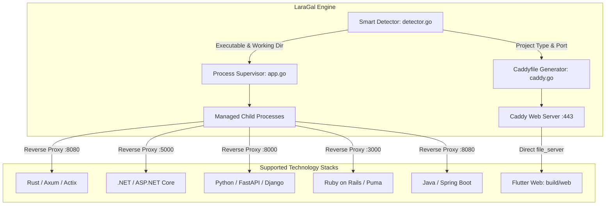

# Multi-Language & Runtime Hosting Implementation Plan

> **For agentic workers:** REQUIRED SUB-SKILL: Use superpowers:subagent-driven-development to implement this plan task-by-task. Steps use checkbox (`- [ ]`) syntax for tracking.

**Goal:** Expand LaraGal's local hosting architecture to automatically detect, configure, reverse-proxy, and supervise projects across all major web stacks: Rust, .NET / C#, Python Web (FastAPI/Django/Flask), Ruby (Rails/Sinatra), Java/Kotlin (Spring Boot), and Flutter Web.

**Architecture:**
- Extend `detector.go` with specialized detection signatures for each language ecosystem (e.g., `Cargo.toml`, `*.csproj`, `Gemfile`, `pom.xml`, `requirements.txt`, `pubspec.yaml`), assigning appropriate `ProjectType`, `DocRoot`, and default `ProxyPort`.
- Update `caddy.go` to generate optimized `reverse_proxy` blocks with static asset offloading (`handle /static/*` or `handle /wwwroot/*`) and customized localized error fallback handling.
- Extend `app.go` with unified process spawning logic in `StartProjectApp` supporting compiled binaries and CLI dev servers with working-directory isolation.
- Update `frontend/src/App.vue` and locale dictionaries with dedicated filter tabs, ecosystem badges, and control toggles.

**Architecture Diagram:**

**Tech Stack:** Go 1.22+, Caddy Server 2.8+, Wails v2, Vue 3, Tailwind CSS v4.

**Spec:** [docs/superpowers/specs/2026-10-19-laragal-design.md](file:///d:/projects/laragal/docs/superpowers/specs/2026-10-19-laragal-design.md)

## Global Constraints
- Zero external runtime installation required by LaraGal binary itself.
- Standard library first, strict adherence to ponytail minimal code ladder.
- All reverse-proxied domains must receive trusted local `https://<name>.test` SSL certificates automatically.
- Strict BiDi RTL compliance for all new UI badges and text strings.
- 100% test coverage across all new detection rules.

---

### Task 1: Core Type Definitions & Smart Detector Extension

**Files:**
- Modify: `internal/projects/detector.go`
- Test: `internal/projects/detector_test.go`

**Interfaces:**
- Consumes: Project directory structure (`cleanDir`).
- Produces: `DetectedProject` with `TypeRust`, `TypeDotNet`, `TypePython`, `TypeRuby`, `TypeJava`, `TypeFlutter`.

- [ ] **Step 1: Write failing detector unit tests**
  Add unit tests in `internal/projects/detector_test.go` verifying detection of:
  - Rust project with `Cargo.toml` (`TypeRust`, port 8080).
  - .NET project with `app.csproj` (`TypeDotNet`, port 5000, docroot `wwwroot`).
  - Python FastAPI/Django with `manage.py` / `requirements.txt` (`TypePython`, port 8000).
  - Ruby on Rails project with `Gemfile` (`TypeRuby`, port 3000, docroot `public`).
  - Java Spring Boot with `pom.xml` (`TypeJava`, port 8080).
  - Flutter Web with `pubspec.yaml` containing `flutter:` (`TypeFlutter`, docroot `build/web`).

- [ ] **Step 2: Run tests to confirm failure**
  Run `go test ./internal/projects/...` and verify tests fail for the new types.

- [ ] **Step 3: Implement new types and detection rules in `detector.go`**
  - Add constants: `TypeRust`, `TypeDotNet`, `TypePython`, `TypeRuby`, `TypeJava`, `TypeFlutter`.
  - Add detection functions:
    - `detectRust(cleanDir)`: checks `Cargo.toml`.
    - `detectDotNet(cleanDir)`: checks `*.csproj`, `*.sln`, looks for `wwwroot`.
    - `detectPython(cleanDir)`: checks `manage.py`, `pyproject.toml`, `requirements.txt`, looks for `static`.
    - `detectRuby(cleanDir)`: checks `Gemfile`, `config.ru`, looks for `public`.
    - `detectJava(cleanDir)`: checks `pom.xml`, `build.gradle`.
    - `detectFlutter(cleanDir)`: checks `pubspec.yaml` with `flutter:`, docroot `build/web`.

- [ ] **Step 4: Verify detector tests pass**
  Run `go test ./internal/projects/...` and verify 100% pass.

---

### Task 2: Dynamic Caddyfile Generation for Multi-Runtime Stacks

**Files:**
- Modify: `internal/services/caddy/caddy.go`
- Test: `internal/services/caddy/caddy_test.go`

**Interfaces:**
- Consumes: `SiteDef` slice with various `ProjectType` values.
- Produces: Formatted Caddyfile string with optimized static handling, proxy headers, and localized error pages.

- [ ] **Step 1: Write failing Caddyfile generator unit tests**
  Add tests in `internal/services/caddy/caddy_test.go` verifying:
  - .NET site proxies to port 5000 and serves `/wwwroot/*` directly.
  - Python site proxies to port 8000 and serves `/static/*` directly.
  - Ruby site proxies to port 3000 and serves `/public/*` directly.
  - Flutter site serves static files from `build/web` without proxying.

- [ ] **Step 2: Update `GenerateCaddyfile` in `caddy.go`**
  - Group reverse-proxy handling for `go`, `rust`, `dotnet`, `python`, `ruby`, `java`, `proxy`.
  - Automatically map static asset prefixes (`/static/*`, `/wwwroot/*`, `/assets/*`).
  - Output clean `handle_errors` blocks with contextual application names.

- [ ] **Step 3: Verify Caddy unit tests pass**
  Run `go test ./internal/services/caddy/...` and confirm all tests pass.

---

### Task 3: Universal Process Supervisor in Backend

**Files:**
- Modify: `app.go`
- Test: `app_test.go`

**Interfaces:**
- Consumes: `projectPath`, `port`, `projectType`.
- Produces: Started child process managed by `a.supervisor` with working directory set to `projectPath`.

- [ ] **Step 1: Write tests for `StartProjectApp` resolution**
  Verify binary detection cascade:
  - `<name>.exe`, `server.exe`, `main.exe`, `app.exe`
  - Fallback runners: `cargo run --release`, `dotnet run`, `python manage.py runserver`, `bundle exec rails s`, `java -jar`.

- [ ] **Step 2: Implement runner dispatch in `StartProjectApp` in `app.go`**
  Add runner mappings for each ecosystem with proper CLI arguments and port forwarding.

- [ ] **Step 3: Test and verify process supervision**
  Run `go test ./...` across all packages.

---

### Task 4: Frontend UI Filter Tabs & BiDi Ergonomics

**Files:**
- Modify: `frontend/src/App.vue`
- Modify: `frontend/src/locales/ar.json`
- Modify: `frontend/src/locales/en.json`

**Interfaces:**
- Consumes: `sites` list with updated `project_type` labels.
- Produces: Enhanced project filtering bar, ecosystem badges, and 1-click start/stop controls.

- [ ] **Step 1: Add localization keys**
  Add filter and status keys for Rust, .NET, Python, Ruby, Java, and Flutter in `ar.json` and `en.json`.

- [ ] **Step 2: Update filter strip in `App.vue`**
  Add filter pills: `All`, `Laravel`, `PHP`, `Go`, `Node.js`, `Python`, `Rust`, `.NET`, `Static`.

- [ ] **Step 3: Fix Directory Picker Dialog Title**
  Update `SelectProjectsDirectory` in `app.go` to use pure Arabic title `"اختر مجلد المشاريع لـ LaraGal"`.

- [ ] **Step 4: Build and verify frontend & desktop binary**
  Run `build.bat` and verify successful compilation.
