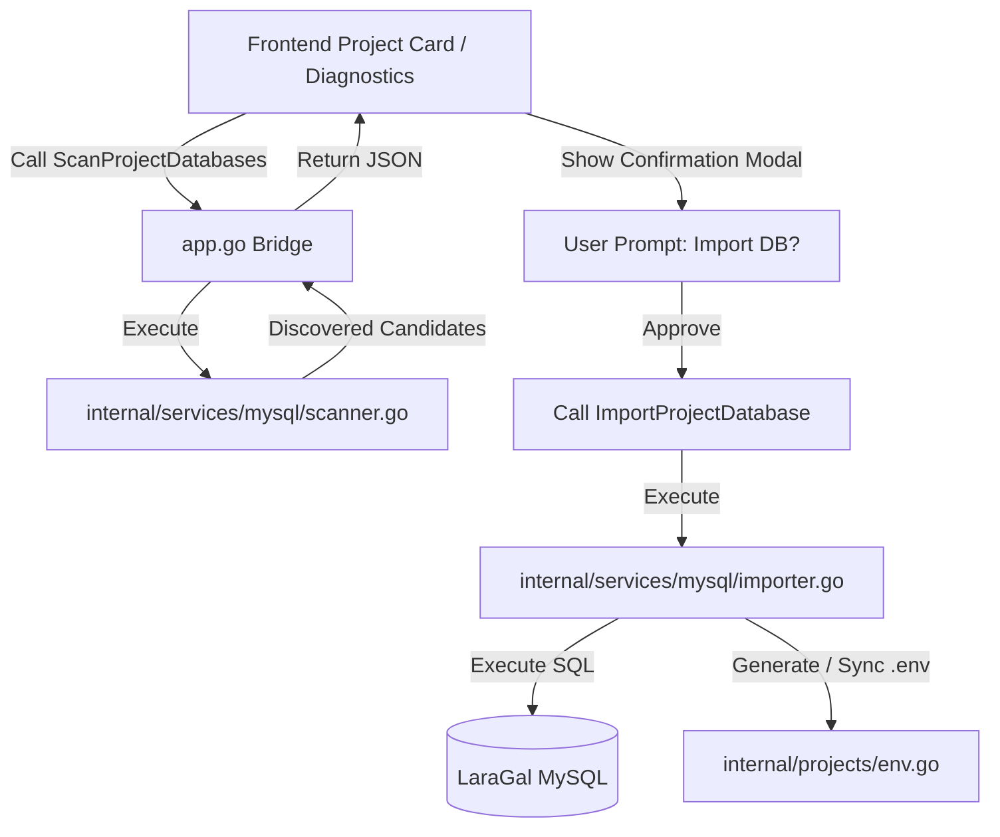

# Legacy Database Discovery and Import Implementation Plan

> **For agentic workers:** REQUIRED SUB-SKILL: Use superpowers:subagent-driven-development to implement this plan task-by-task. Steps use checkbox (`- [ ]`) syntax for tracking.

**Goal:** Provide automated discovery of preexisting project database schemas and legacy MySQL data directories, presenting an interactive user prompt to import them into LaraGal's managed MySQL environment with automated `.env` synchronization.

**Architecture:** A Go-based scanner in `internal/services/mysql` inspects project trees for `.sql` schemas and scans host paths for legacy MySQL directories. Discovered databases are surfaced via Wails bindings to an ergonomic BiDi modal dialog in the Vue 3 frontend. Upon user approval, an importer creates the database in LaraGal MySQL, applies the schema safely, and synchronizes the project's `.env`.

**Architecture Diagram:**



**Tech Stack:** Go 1.22+, Wails v2, Vue 3, Tailwind CSS v4, MySQL / MariaDB, BiDi Core.

**Spec:** `docs/superpowers/specs/2026-10-21-legacy-database-discovery-and-import-design.md`

## Global Constraints
- Strictly maintain backwards compatibility with existing LaraGal services and project detection.
- All frontend text and messages presented to the user must be bilingual with full Arabic RTL support according to `arabic-bidi-engineering`.
- Non-destructive execution: preexisting files and schemas must never be modified, overwritten, or deleted during discovery or import.
- Follow TDD: every task must include failing tests before implementation.

---

### Task 1: Discovery Engine Structures & Schema Scanner

**Files:**
- Create: `internal/services/mysql/scanner.go`
- Test: `internal/services/mysql/scanner_test.go`

**Interfaces:**
- Produces:
  ```go
  type DiscoveredDatabase struct {
      Type        string   `json:"type"`
      SourcePath  string   `json:"source_path"`
      TargetDB    string   `json:"target_db"`
      FileName    string   `json:"file_name"`
      SizeBytes   int64    `json:"size_bytes"`
      Description string   `json:"description"`
      FoundTables []string `json:"found_tables"`
  }
  func ScanProjectForSchemas(projectPath string) ([]DiscoveredDatabase, error)
  func ExtractTableNamesFromSQL(content string) []string
  ```

- [ ] **Step 1: Write the failing unit tests**
  Write tests in `internal/services/mysql/scanner_test.go` verifying:
  - Detection of schema files in temp test directories (e.g. `schema.sql`, `dump.sql`).
  - Table name extraction from `CREATE TABLE` statements (including `IF NOT EXISTS` and backticks).
  - Target database name normalization (e.g. `audit-platform` -> `audit_platform`).

- [ ] **Step 2: Run tests to verify failure**
  Run `go test ./internal/services/mysql -v` and confirm tests fail as implementation does not exist.

- [ ] **Step 3: Implement minimal scanner code**
  Implement `internal/services/mysql/scanner.go` with directory traversal up to depth 4, file size collection, regex table parser, and candidate ranking.

- [ ] **Step 4: Run tests to verify passing**
  Run `go test ./internal/services/mysql -v` and ensure all tests pass.

- [ ] **Step 5: Commit changes**
  Commit Task 1 changes with git message: `feat(mysql): add schema and legacy database discovery engine`.

---

### Task 2: Host Legacy MySQL Directory Detection

**Files:**
- Modify: `internal/services/mysql/scanner.go`
- Test: `internal/services/mysql/scanner_test.go`

**Interfaces:**
- Produces:
  ```go
  func ScanHostForLegacyDatabases(targetDBHint string) []DiscoveredDatabase
  func ScanAllDatabases(projectPath string) ([]DiscoveredDatabase, error)
  ```

- [ ] **Step 1: Write failing unit tests**
  Add tests for `ScanHostForLegacyDatabases` using mocked directory structures simulating Laragon/XAMPP data directories, ensuring system databases (`mysql`, `sys`, `performance_schema`, `information_schema`) are filtered out.

- [ ] **Step 2: Run tests to verify failure**
  Run `go test ./internal/services/mysql -run TestScanHostForLegacyDatabases -v`.

- [ ] **Step 3: Implement host scanning logic**
  Implement `ScanHostForLegacyDatabases` scanning standard paths (`C:\laragon\data\mysql`, `D:\laragon\data\mysql`, `C:\xampp\mysql\data`, `D:\xampp\mysql\data`).

- [ ] **Step 4: Run tests to verify passing**
  Run `go test ./internal/services/mysql -v` and verify clean execution.

- [ ] **Step 5: Commit changes**
  Commit Task 2 changes with git message: `feat(mysql): add host legacy MySQL directory scanning`.

---

### Task 3: Database Importer & .env Synchronizer

**Files:**
- Create: `internal/services/mysql/importer.go`
- Test: `internal/services/mysql/importer_test.go`
- Modify: `internal/projects/env.go`

**Interfaces:**
- Produces:
  ```go
  func ImportSchemaFile(sqlPath string, targetDB string) error
  func SyncProjectDatabaseEnv(projectPath string, targetDB string) error
  ```

- [ ] **Step 1: Write failing unit tests**
  Write tests in `internal/services/mysql/importer_test.go` for:
  - Creating `.env` from `.env.example` when `.env` is absent, updating `DB_DATABASE`, `DB_HOST`, `DB_PORT`, `DB_USERNAME`, `DB_PASSWORD`.
  - Updating existing `.env` with new target DB name without destroying existing application keys.

- [ ] **Step 2: Run tests to verify failure**
  Run `go test ./internal/services/mysql -run TestSyncProjectDatabaseEnv -v`.

- [ ] **Step 3: Implement environment synchronizer and SQL execution helper**
  Implement `SyncProjectDatabaseEnv` in `internal/services/mysql/importer.go` reusing `internal/projects/env.go`.

- [ ] **Step 4: Run tests to verify passing**
  Run `go test ./internal/services/mysql -v`.

- [ ] **Step 5: Commit changes**
  Commit Task 3 changes with git message: `feat(mysql): implement database importer and env synchronizer`.

---

### Task 4: Wails Bridge Integration in `app.go`

**Files:**
- Modify: `app.go`
- Test: `app_test.go`

**Interfaces:**
- Produces:
  ```go
  func (a *App) ScanProjectDatabases(projectPath string) ([]mysql.DiscoveredDatabase, error)
  func (a *App) ImportProjectDatabase(projectPath string, candidate mysql.DiscoveredDatabase) (bool, error)
  ```

- [ ] **Step 1: Write integration test in `app_test.go`**
  Add test verifying `ScanProjectDatabases` invokes scanner on project directories.

- [ ] **Step 2: Run test to verify failure**
  Run `go test -run TestScanProjectDatabases -v`.

- [ ] **Step 3: Implement Wails bridge methods in `app.go`**
  Wire scanner and importer into `App` struct with proper error handling and logging.

- [ ] **Step 4: Run test to verify passing**
  Run `go test -run TestScanProjectDatabases -v`.

- [ ] **Step 5: Commit changes**
  Commit Task 4 changes with git message: `feat(app): expose database discovery and import methods to frontend`.

---

### Task 5: Frontend UI Confirmation Modal & Diagnostics Integration

**Files:**
- Modify: `frontend/src/App.vue` (or project diagnostic components)
- Modify: `frontend/src/locales/ar.json` & `frontend/src/locales/en.json` (or i18n dictionaries)

- [ ] **Step 1: Add Arabic and English localized strings**
  Add keys for modal title, prompt message, detected schema table list, import button, skip button, and success toast:
  - `db_discovery_title`: «اكتشاف قواعد البيانات السابقة»
  - `db_discovery_prompt`: «عثر LaraGal على مخطط قاعدة بيانات سابق للمشروع. هل ترغب في نسخه واستيراده تلقائيًا؟»
  - `db_import_btn`: «استيراد ونسخ الآن»
  - `db_skip_btn`: «تخطي»

- [ ] **Step 2: Add database discovery banner / modal to Project Card / Diagnostics**
  When project has missing DB connection or when user clicks diagnostics, trigger `ScanProjectDatabases`. If results found, display the BiDi confirmation dialog.

- [ ] **Step 3: Wire import button action with loading feedback**
  Call `ImportProjectDatabase` upon user click, show spinner, and update project status to healthy upon completion.

- [ ] **Step 4: Build frontend bundle and verify no errors**
  Run `npm run build` inside `frontend/` to ensure compile-time type safety and asset generation.

- [ ] **Step 5: Commit changes**
  Commit Task 5 changes with git message: `feat(ui): add interactive database discovery and import modal`.

---

### Task 6: Full Verification on Real Project (`audit-platform`)

- [ ] **Step 1: Execute test scan on `D:\projects\audit-platform`**
  Verify scanner correctly returns `D:\projects\audit-platform\src\Infrastructure\Database\schema.sql` with table names (`users`, `sessions`, `audit_tasks`).
- [ ] **Step 2: Verify `.env` generation for `audit-platform`**
  Verify that upon import approval, `D:\projects\audit-platform\.env` is generated from `.env.example` with `DB_DATABASE=audit_platform`.
- [ ] **Step 3: Run full test suite**
  Run `go test ./...` across the repository to verify all tests pass.
