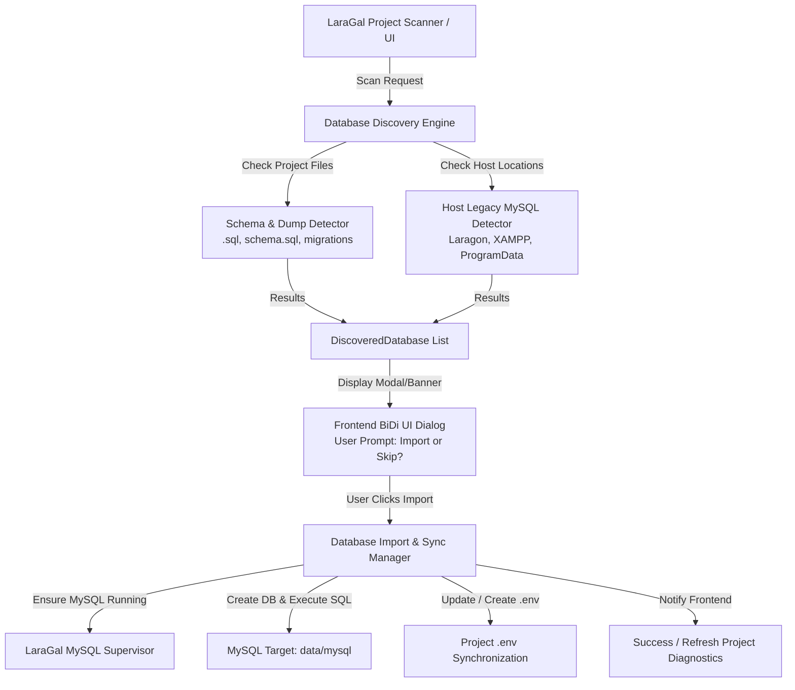

# Legacy Database & Schema Discovery and Import Specification

## 1. Context and Problem Statement
When developers migrate projects to **LaraGal** or run projects that have preexisting database schemas or legacy database folders (from Laragon, XAMPP, or standalone MySQL installations), the project often crashes with connection errors (e.g., `SQLSTATE[HY000] [2002] No connection could be made because the target machine actively refused it`).

Currently, LaraGal:
1. Detects project types and configures Caddy and PHP-FPM ports.
2. Generates default `.env` variables if requested, but does not auto-discover existing `.sql` schema files or legacy database directories on the host.
3. Does not proactively prompt the user to migrate or import their preexisting data.

This specification defines the architecture for **automated discovery, user confirmation, and safe zero-data-loss import** of preexisting databases into LaraGal's managed MySQL environment.

---

## 2. Architecture and Data Flow



---

## 3. Detailed Component Design

### 3.1 Backend Discovery Engine (`internal/services/mysql/scanner.go`)

#### Data Structures
```go
package mysql

type DiscoveredDatabase struct {
    Type        string   `json:"type"`         // "schema_file" | "legacy_server_dir"
    SourcePath  string   `json:"source_path"`  // Absolute path to .sql file or data folder
    TargetDB    string   `json:"target_db"`    // Suggested normalized database name (e.g. audit_platform)
    FileName    string   `json:"file_name"`    // Display name (e.g. schema.sql)
    SizeBytes   int64    `json:"size_bytes"`   // Size of the schema/dump file
    Description string   `json:"description"`  // Contextual description in Arabic & English
    FoundTables []string `json:"found_tables"` // Sample tables detected inside the schema
}
```

#### Discovery Rules
1. **Project Directory Scan:**
   - Recursively search project directory (up to depth 4) for candidate schema files:
     - `schema.sql`, `dump.sql`, `database.sql`, `init.sql`, `setup.sql`, `dev-setup*.sql`
     - Files inside `database/`, `sql/`, `Infrastructure/Database/`, `migrations/`.
   - Inspect `.sql` content safely (first 64 KB) with regex to extract table names (`CREATE TABLE (IF NOT EXISTS)? [`"`]?([a-zA-Z0-9_]+)`).

2. **Host Local MySQL Scan:**
   - Check standard local environment paths:
     - `C:\laragon\data\mysql\<dbname>`
     - `D:\laragon\data\mysql\<dbname>`
     - `C:\xampp\mysql\data\<dbname>`
     - `D:\xampp\mysql\data\<dbname>`
   - Filter out MySQL system schemas: `mysql`, `information_schema`, `performance_schema`, `sys`.

---

### 3.2 Backend Importer & Synchronizer (`internal/services/mysql/importer.go`)

#### Responsibilities
1. **Database Creation:**
   - Normalize target database name from project name or custom input (replace dashes with underscores).
   - Execute `CREATE DATABASE IF NOT EXISTS <target_db> CHARACTER SET utf8mb4 COLLATE utf8mb4_unicode_ci;`.
2. **Schema / Dump Execution:**
   - Execute the statements from the discovered `.sql` file into the target database.
   - Guard against dangerous operations or report detailed execution stats.
3. **Environment Sync:**
   - If `.env` exists in the project: ensure `DB_DATABASE=<target_db>`, `DB_HOST=127.0.0.1`, `DB_PORT=3306`, `DB_USERNAME=root`, `DB_PASSWORD=`.
   - If `.env` does not exist but `.env.example` exists: copy `.env.example` to `.env` and inject the matching database credentials.

---

### 3.3 Wails App Bridge (`app.go`)

Expose methods to Vue 3 frontend:
- `ScanProjectDatabases(projectPath string) ([]mysql.DiscoveredDatabase, error)`
- `ImportProjectDatabase(projectPath string, item mysql.DiscoveredDatabase) (bool, error)`

---

### 3.4 Frontend UI Modal & Notification (`frontend/src`)

- Modal dialog triggered when user clicks "فحص قواعد البيانات السابقة" or automatically when project diagnostics report missing DB connection but candidate schemas exist.
- BiDi compliant: RTL alignment, Arabic typography, respectful clear wording.
- Features:
  - List of detected schemas with table count and file size.
  - Recommended action badge.
  - Buttons: `«استيراد ونسخ الآن»` with loading spinner, and `«إلغاء / تخطي»`.
  - Instant status feedback.

---

## 4. Verification and Testing Strategy
1. **Unit Tests (`internal/services/mysql/scanner_test.go`):**
   - Test detection on projects with `schema.sql`.
   - Test table name regex extraction.
   - Test system database exclusion.
2. **Importer Tests (`internal/services/mysql/importer_test.go`):**
   - Test normalization of project names to valid MySQL identifiers.
   - Test `.env` generation when only `.env.example` exists.
3. **End-to-End Verification:**
   - Run `ScanProjectDatabases("D:\\projects\\audit-platform")` and verify it detects `schema.sql` with tables (`users`, `sessions`, `audit_tasks`).
